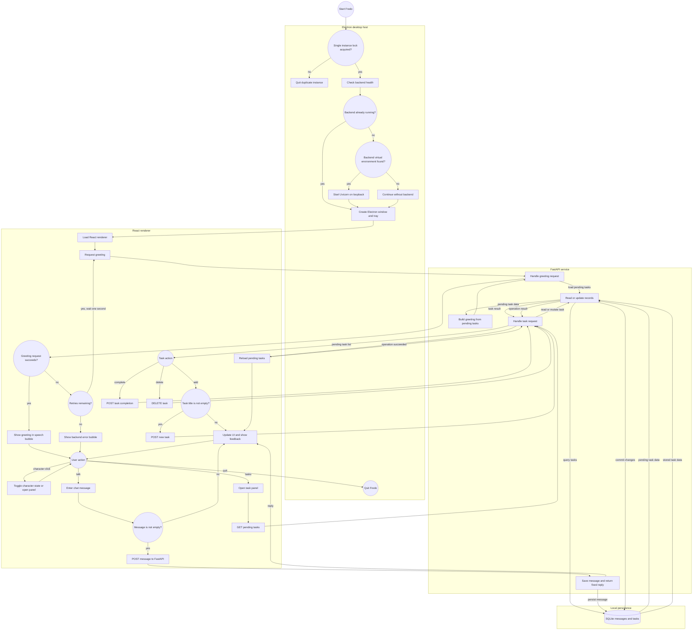

# Architecture Diagram

Fredo is a desktop companion application with a React interface, an Electron host, and a local FastAPI service backed by SQLite. The diagrams show the app startup path and the main greeting, chat, and task workflows; no browser-extension source files are present in this workspace.

## Application Architecture

<!-- mermaid-checked: no \n, no em-dash/en-dash, no {} in labels, subgraphs are id["label"], arrows are -->|"label"|, all subgraphs closed by end, ids unique -->

### Technology Stack Summary

| Layer | Technology | Version | Purpose |
|---|---|---|---|
| Desktop host | Electron | 45.3.0 | Window, tray, process lifecycle, and preload bridge |
| Renderer | React | 19.3.1 | Fredo character, chat, and task interface |
| Renderer language | TypeScript | 6.0.3 | UI and API client implementation |
| Frontend tooling | Vite | 8.3.6 | Renderer development server and production build |
| Backend | Python and FastAPI | FastAPI 0.162.4 | Local HTTP API and request validation |
| ORM | SQLAlchemy | 2.1.9 | Database models and persistence |
| Data store | SQLite | Not pinned | Local message and task storage |

### Data Storage & External Services

The backend uses the local `BACKEND/fredo.db` SQLite database for messages and tasks through SQLAlchemy. The desktop renderer calls the FastAPI service at `127.0.0.1:8000`; the Electron host checks `/health` and starts Uvicorn when needed. The renderer is served by Vite at `127.0.0.1:5173` in the current configuration. No external APIs, caches, or message brokers were found.

### Key Architectural Decisions

- The Electron main process owns the app lifecycle and starts the Python backend when its virtual environment is available.
- The React renderer communicates with the backend over HTTP; Electron exposes only a window-resize API through the preload bridge.
- FastAPI routes delegate database operations to a repository layer, which uses SQLAlchemy models and SQLite.

## Component Relationships

```mermaid
flowchart LR
    subgraph ElectronLayer["Electron host"]
        cMain["Electron main process"]
        cPreload["Preload bridge"]
    end
    subgraph PresentationLayer["React presentation"]
        cEntry["Renderer entry point"]
        cApp["App"]
        cCharacter["Character"]
        cTaskPanel["TaskPanel"]
        cApi["API client"]
    end
    subgraph BackendLayer["FastAPI backend"]
        cFastAPI["FastAPI routes"]
        cGreeting["Greeting builder"]
        cSchemas["Pydantic schemas"]
        cRepository["Repository"]
    end
    subgraph PersistenceLayer["Persistence"]
        cModels["SQLAlchemy models"]
        cDatabase["Database session and engine"]
        cSQLite[("SQLite database")]
    end

    cMain -->|"loads renderer"| cEntry
    cMain -->|"starts and checks"| cFastAPI
    cMain -->|"sends resize IPC"| cPreload
    cPreload -->|"exposes resize API"| cApp
    cEntry -->|"renders"| cApp
    cApp -->|"shows"| cCharacter
    cApp -->|"opens"| cTaskPanel
    cApp -->|"requests greeting and chat"| cFastAPI
    cTaskPanel -->|"task operations"| cApi
    cApi -->|"HTTP requests"| cFastAPI
    cFastAPI -->|"validates requests"| cSchemas
    cFastAPI -->|"builds greeting"| cGreeting
    cFastAPI -->|"reads and writes"| cRepository
    cGreeting -->|"uses pending tasks"| cRepository
    cRepository -->|"queries and updates"| cModels
    cModels -->|"uses session"| cDatabase
    cDatabase -->|"SQLite connection"| cSQLite
```

<!-- mermaid-checked: no \n, no em-dash/en-dash, no {} in labels, subgraphs are id["label"], arrows are -->|"label"|, all subgraphs closed by end, ids unique -->

### Component Inventory

| Component | Layer | Type | Responsibility |
|---|---|---|---|
| Electron main process | Desktop host | Electron main process | Enforces a single instance, manages the window and tray, and starts or stops the backend |
| Preload bridge | Desktop host | Context bridge | Exposes a constrained window-resize call to the renderer |
| Renderer entry point | React presentation | React bootstrap | Mounts the React application |
| App | React presentation | React component | Handles greeting, chat, character state, and panel visibility |
| Character | React presentation | React component | Renders the interactive Fredo character |
| TaskPanel | React presentation | React component | Lists, creates, completes, and deletes tasks |
| API client | React presentation | HTTP client | Sends task requests to the local backend |
| FastAPI routes | Backend | API routes | Handles health, message, greeting, and task list, create, update, completion, and delete requests |
| Greeting builder | Backend | Domain helper | Builds a greeting from the current time and pending tasks |
| Pydantic schemas | Backend | Request and response models | Validates message and task data and shapes task responses |
| Repository | Backend | Data access layer | Implements message and task queries and mutations |
| SQLAlchemy models | Persistence | ORM models | Maps messages and tasks to database tables |
| Database session and engine | Persistence | Database configuration | Creates SQLite connections and request-scoped sessions |
| SQLite database | Persistence | Database | Stores messages and tasks locally |
